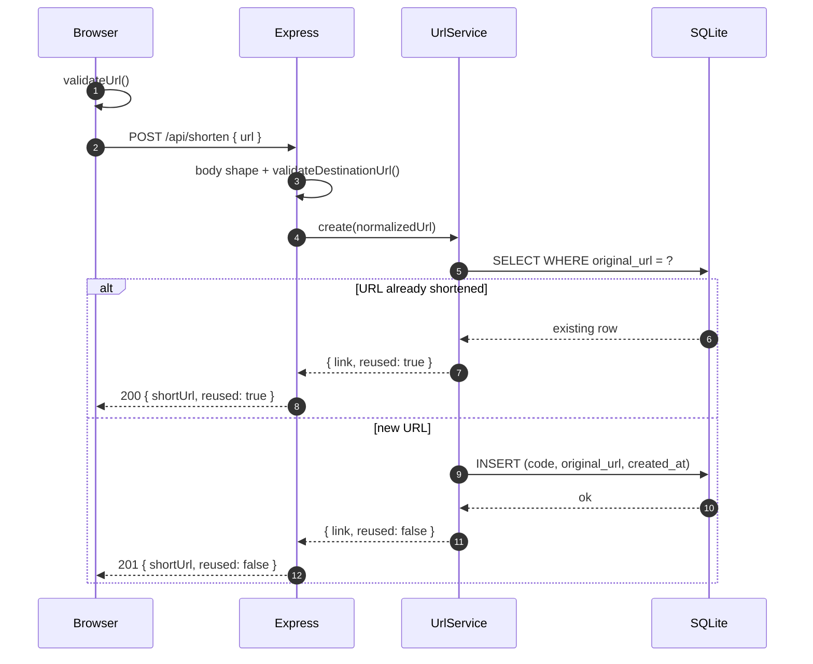
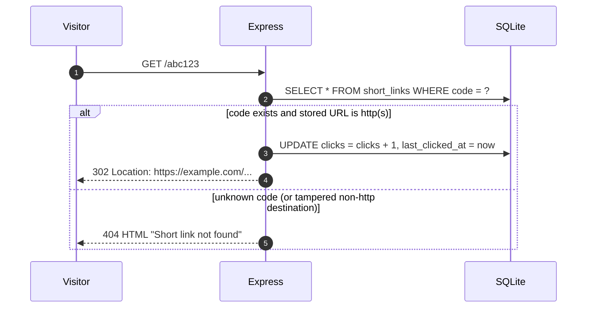

# LinkCraft — Developer & Product Guide

This document explains **what LinkCraft is, why it is built the way it is, and how every
part works** — from the user flows down to the SQL rows. It is aimed at a developer joining
the project who needs the mental model before touching code.

- Setup, env vars and deployment commands live in [`README.md`](../README.md).
- Rules and gotchas for AI coding agents live in [`AGENTS.md`](../AGENTS.md).
- This file is the deep explanation that ties the two together.

---

## Table of contents

1. [Product](#1-product)
2. [System overview](#2-system-overview)
3. [End-to-end flows](#3-end-to-end-flows)
4. [Frontend architecture](#4-frontend-architecture)
5. [Backend architecture](#5-backend-architecture)
6. [Data model](#6-data-model)
7. [API reference](#7-api-reference)
8. [Configuration](#8-configuration)
9. [Testing](#9-testing)
10. [Build, deploy and operations](#10-build-deploy-and-operations)
11. [Security and threat model](#11-security-and-threat-model)
12. [Extending the system](#12-extending-the-system)
13. [Glossary](#13-glossary)

---

## 1. Product

### 1.1 What it is

LinkCraft is a small, account-less web tool with two jobs:

1. **Turn any link into a QR code** you can download and print.
2. **Turn a long link into a short link** that actually redirects.

Both live on one page, share one visual language, and feed a single **Recent activity**
section. The product is deliberately narrow: no dashboards, no campaigns, no billing, no
accounts.

### 1.2 Who it is for

| User                   | Job to be done                                                     |
| ---------------------- | ------------------------------------------------------------------ |
| Event / marketing user | Put a scannable code on a poster, slide or menu                    |
| Casual sharer          | Get a short link for a long URL and a QR code in the same session  |
| Self-hoster            | Run a tiny link tool on one box without a database server          |
| Developer              | Learn a clean full-stack reference implementation                  |

### 1.3 Product principles

1. **QR generation is local.** The link is never sent to a server to be encoded, so it works
   offline after the page loads and stays private.
2. **Short links are real.** A short URL is a database record with an HTTP redirect — never a
   cosmetic string generated in the UI.
3. **No fake success.** The UI only shows a short link after the API confirms it; failures are
   surfaced, never swallowed.
4. **Simple by default, powerful on demand.** One input and one button; customisation is
   available but not in the way.
5. **Accessible and fast as a baseline.** Semantic HTML, keyboard support, visible focus and
   `prefers-reduced-motion` are not afterthoughts.

### 1.4 Feature map

| Feature                 | Where                                   | Notes                                                             |
| ----------------------- | --------------------------------------- | ----------------------------------------------------------------- |
| URL validation          | `client/src/lib/url-validation.ts`      | Adds `https://` when missing, rejects non-http(s)                 |
| QR preview              | `client/src/components/QRCodePreview.tsx` | Canvas render, derived loading state, contrast warning          |
| QR customisation        | `QRCodeGenerator.tsx`                   | Size, foreground, background, error correction, 5 presets         |
| PNG download            | `client/src/lib/qr.ts`                  | Blob URL + `<a download>`, high resolution                        |
| Copy to clipboard       | `CopyButton.tsx` + `lib/clipboard.ts`   | Async Clipboard API with `execCommand` fallback                   |
| Shorten URL             | `POST /api/shorten`                     | Validated, de-duplicated, persisted                               |
| Copy / open short link  | `URLShortener.tsx`                      | Result card, opens in a new tab                                   |
| QR for short link       | `URLShortener.tsx` → `QRCodePreview`    | Encodes the absolute short URL                                    |
| Server history          | `GET /api/links` + `lib/link-store.ts`  | Global recent list, click counts                                  |
| Local QR history        | `lib/storage.ts` + `HistoryList.tsx`    | Opt-in localStorage, max 20 entries                               |
| Redirect                | `GET /:code`                            | 302 to destination, increments clicks                             |
| 404 page                | `server/src/routes/redirect.ts`         | Styled HTML for unknown codes                                     |
| Responsive navigation   | `Header.tsx`                            | Disclosure menu on mobile                                         |
| About / empty states    | `About.tsx`, `HistoryList.tsx`          | Explains the product and sets expectations                        |

### 1.5 User journeys

**A. QR only (no server involved)**

```
Paste URL → validate → Generate → preview → customise → Download PNG
```

**B. Shorten, then share and print**

```
Paste URL → Shorten → server returns short URL → Copy / Open
                                        └→ "Generate QR code for this short link" → Download PNG
```

**C. Someone scans or clicks the short link**

```
Open https://host/abc123 → 302 Location: https://example.com/... → destination
Open https://host/unknown → 404 page → "Create a new link"
```

**D. Return visit**

```
Open the app → Recent activity lists server links (all users) + local QR codes (this browser)
```

### 1.6 Non-goals and known limitations

These are conscious trade-offs, not bugs. Document them rather than "fixing" them silently.

| Limitation                                | Why it exists                                                                 | Consequence                                                                 |
| ----------------------------------------- | ----------------------------------------------------------------------------- | --------------------------------------------------------------------------- |
| No accounts or auth                       | Keeps the product frictionless and the code small                              | `/api/links` shows the **global** recent list, not "your" links              |
| No link editing, deletion or expiry       | Not in scope for v1                                                            | `UrlService.delete()` exists but is not exposed over HTTP                   |
| No per-link analytics                     | Avoids tracking and a second data model                                        | Only total clicks and last-click time are stored                            |
| Same destination reuses one code          | Keeps the table tidy and makes shortening idempotent                           | Two campaigns for the same URL need a query parameter to get separate codes |
| Click counts include bots                 | We only know that a redirect was served                                        | Numbers are directional, not unique-visitor analytics                      |
| SQLite on a single instance               | Zero-ops persistence and simple local development                              | No horizontal scaling without swapping the database                        |
| In-memory rate limiting                   | No Redis dependency                                                            | Limits are per process; multiple instances dilute them                     |
| Free hosts are ephemeral                  | Render's free tier has no persistent disk                                      | SQLite data is lost on restart/redeploy — move to Turso or a volume         |
| The React 404 page is mostly a dev route  | In production, `/:code` owns every path that is not `/` or `/assets`           | Unknown URLs get the server's HTML 404, not `NotFound.tsx`                 |
| No domain per link                        | Short links always use `BASE_URL`                                              | Moving domains invalidates previously printed QR codes                     |

---

## 2. System overview

### 2.1 Architecture

```
┌─────────────────────────────── Browser ────────────────────────────────┐
│  React 19 SPA (built by Vite)                                          │
│                                                                        │
│  Header · Hero · QRCodeGenerator · URLShortener · HistoryList · About  │
│        │                    │                       │                  │
│   qrcode → <canvas>    fetch /api/*          localStorage (QR only)    │
│                             │                                          │
│                   link-store (useSyncExternalStore)                    │
└─────────────────────────────┬──────────────────────────────────────────┘
                              │  same origin in prod · Vite proxy in dev
┌─────────────────────────────▼──────────────────────────────────────────┐
│  Express 5 (Node 22, ESM)                                              │
│                                                                        │
│  helmet → cors → json(16 kB) → rate limit → /api → static → /:code     │
│                                                                        │
│  routes ──► UrlService ──► better-sqlite3                              │
└─────────────────────────────┬──────────────────────────────────────────┘
                              ▼
                 SQLite file: server/data/linkcraft.db
```

### 2.2 Deployment topologies

| Topology              | Browser talks to                    | Short link host              | Notes                                                        |
| --------------------- | ----------------------------------- | ---------------------------- | ------------------------------------------------------------ |
| Development           | `localhost:5173` (Vite proxy)       | `http://localhost:4000`      | HMR, single origin for the browser, no CORS needed           |
| Single service (prod) | Express on `BASE_URL`               | Same host                    | `SERVE_CLIENT=true`; simplest and recommended                 |
| Split hosting         | Static host → API via `VITE_API_BASE_URL` | API host               | Requires `CORS_ORIGIN`; QR/short links point at the API host  |

### 2.3 Why these technologies

- **React + Vite + Tailwind** — the app is one interactive page; no SSR or routing framework is
  needed, so the bundle stays small and the tooling simple.
- **`qrcode`** — mature library that can draw to a canvas in the browser and produce PNG data
  URLs in Node (which is what the tests rely on).
- **Express 5** — explicit middleware order makes the redirect/API/static boundary easy to
  reason about and to secure.
- **`better-sqlite3`** — synchronous, zero-configuration and very fast for a single-node app;
  the price is that it is not a client/server database, which caps scaling.
- **No state library** — local state is enough except for the one piece of shared server data,
  which uses a 25-line external store.

---

## 3. End-to-end flows

### 3.1 QR code generation (100% client-side)

`QRCodeGenerator` owns the form; `QRCodePreview` owns the canvas; `lib/qr.ts` wraps `qrcode`.

1. **Input.** The URL lives in local state. Each keystroke clears a visible error.
2. **Submit.** `validateUrl()` trims, rejects empty input and anything over 2048 characters,
   pre-pends `https://` when the scheme is missing, then requires `http:`/`https:` and a
   hostname containing a dot (or `localhost`).
3. **Invalid input.** An inline `role="alert"` message appears and **no canvas work happens** —
   the preview keeps its previous content (or empty state).
4. **Valid input.** The generator stores `encodedUrl`, bumps `renderKey`, sets status to
   `rendering`, and (if local history is enabled) writes a history entry.
5. **Rendering.** `QRCodePreview` runs `renderQrToCanvas(canvas, text, settings)`, which calls:
   ```ts
   QRCode.toCanvas(canvas, text, {
     width: settings.size,          // 256 | 512 | 1024
     margin: 4,                     // quiet zone, mandatory for scanning
     errorCorrectionLevel,          // L | M | Q | H
     color: { dark: foreground, background },
   })
   ```
6. **Status without extra effects.** The preview stores the key of the content it last rendered
   (`text|renderKey`). While that key differs from the current one the derived status is
   `rendering`; once the promise resolves it becomes `ready` (or `error`). No synchronous
   `setState` runs inside an effect (an ESLint error in this repo — see §4.3).
7. **Download.** The button calls `downloadQrPng()`, which regenerates the code at the chosen
   size via `QRCode.toDataURL`, converts it to a Blob, and clicks a temporary `<a download>`.
   The preview canvas is display-only; the download is always full resolution.
8. **Customisation.** Changing size, colours or error correction updates `settings`, which is an
   effect dependency — the code re-renders automatically and the download uses the new values.
9. **Editing after generation.** A 600 ms debounced effect watches the input; if it becomes a
   different valid URL, `encodedUrl` is updated and the preview refreshes. Until then a "stale"
   hint explains what is on screen.
10. **Clear.** Resets the URL, settings, preview and render key.

**Readability guard:** `hasLowContrast()` computes WCAG relative luminance and warns when the
foreground/background ratio is below 3:1. The code is still generated (the user may know what
they are doing), but the warning is explicit.

**Local history entry:** `{ id, url, createdAt, settings }`, de-duplicated by URL, newest first,
capped at 20. Only written when history is enabled (default on) and never sent to the server.

### 3.2 URL shortening



Key details:

- The server **rejects scheme-less input** (`example.com`) even though the client adds
  `https://`. The API contract is "absolute URL".
- Destinations are stored **normalised** (`new URL(input).toString()`), which is also the key
  for de-duplication — `https://example.com` and `https://example.com/` collapse to one row.
- The client never renders a short URL optimistically: the result card is driven by the response.
- A successful response emits `linkcraft:links-changed`, which makes the history section refetch.
- `shortUrl` is **computed at read time** as `${BASE_URL}/${code}`; the database stores only the
  code and the destination. Changing `BASE_URL` changes every displayed link.

### 3.3 Redirect



- **302, not 301.** Every visit must reach the server so clicks are counted, and the service can
  change behaviour later without browsers caching the old target forever. `Cache-Control:
  no-store` reinforces this.
- **Defence in depth.** The stored URL is re-parsed and its protocol re-checked on every
  redirect; a row that somehow contains `javascript:` or a malformed value is treated as a 404.
- **404 page** is server-rendered HTML with the code escaped, a link back to `/`, and a CSP that
  only allows same-origin assets.

### 3.4 History

There are two independent histories, and the UI keeps them visually separate:

| History               | Source                          | Scope                  | Persistence             |
| --------------------- | ------------------------------- | ---------------------- | ----------------------- |
| Shortened links       | `GET /api/links?limit=25`        | Everyone (global)      | SQLite, survives restarts |
| QR codes              | `localStorage`                   | This browser only      | Until cleared / disabled |

- The server list is held in `lib/link-store.ts`, a tiny external store read through
  `useSyncExternalStore`. `refreshLinks()` de-duplicates concurrent calls and is triggered on
  mount and on the `linkcraft:links-changed` event.
- The local list is loaded lazily into state, kept in sync through the
  `linkcraft:history-changed` event, and written by the QR generator on submit.
- Turning the "Save QR history on this device" switch off deletes stored QR history immediately.
- Clearing local history never touches server links, and vice versa.

---

## 4. Frontend architecture

### 4.1 Component tree

```
App
└─ Home
   ├─ Header                (sticky nav, mobile disclosure menu)
   ├─ Hero                  (headline + two tool cards)
   ├─ QRCodeGenerator       (form + settings + preview)
   │  └─ QRCodePreview      (canvas, status, download, copy)
   │     └─ CopyButton
   ├─ URLShortener          (form, result card, optional QR)
   │  ├─ CopyButton
   │  └─ QRCodePreview
   ├─ HistoryList           (server links + local QR history)
   │  ├─ QrThumbnail
   │  ├─ QRCodePreview
   │  └─ CopyButton
   ├─ About
   └─ Footer
NotFound                     (standalone, non-`/` paths)
```

### 4.2 State ownership

| State                          | Owner                              | Persistence                        |
| ------------------------------ | ---------------------------------- | ---------------------------------- |
| URL input, validation error    | `QRCodeGenerator` / `URLShortener` | none                               |
| QR settings                    | `QRCodeGenerator`                  | copied into history entries        |
| Encoded URL, render key, status| `QRCodeGenerator` + `QRCodePreview`| none                               |
| Shorten result                 | `URLShortener`                     | server (via link store refresh)    |
| Server link list / loading     | `lib/link-store.ts`                | SQLite                             |
| Local QR history               | `lib/storage.ts`                   | `localStorage`                     |
| History opt-in                 | `HistoryList` + `storage.ts`       | `localStorage`                     |
| Active tool highlight          | `Home`                             | none                               |

There is no context provider and no global reducer. Cross-component communication happens
through **server state** (the link store) or **DOM events** (`linkcraft:*`), which keeps the
components independent and testable.

### 4.3 Rendering rules and performance

- **No `setState` in an effect body.** ESLint runs the React Compiler rules, and
  `react-hooks/set-state-in-effect` is an error. The codebase handles this two ways:
  derived state (`QRCodePreview`'s status) and an external store (`link-store.ts`).
- QR work only happens when `text`, `settings` or `renderKey` changes; the effect is synchronous
  with respect to rendering and cancels stale promises via a `cancelled` flag.
- Thumbnails use a separate small (56 px) canvas so the history list does not allocate full-size
  images.
- `useCallback` is used where callbacks feed effects; `useMemo` guards the contrast calculation.
- The SPA is a single Vite chunk (~295 kB JS / ~31 kB CSS, ~94 kB JS gzipped). There is no
  route-level code splitting because there is only one route.

### 4.4 Styling system

- Tailwind CSS 4 through `@tailwindcss/vite`; `src/index.css` is the only stylesheet.
- Design tokens in `@theme` (font stack); colours come from Tailwind's default palette.
- Reusable component classes in `@layer components`: `.card`, `.input-field`, `.btn-primary`,
  `.btn-secondary`, `.btn-ghost`, `.section-eyebrow`.
- **Important Tailwind 4 constraint:** `@apply` only accepts utilities, not other custom
  classes. That is why the button base styles use a grouped selector
  (`.btn, .btn-primary, …`) instead of `.btn-primary { @apply btn … }`.
- Layout is mobile-first; the main forms switch to two columns at `lg` (1024 px).
- `prefers-reduced-motion` disables smooth scrolling and transitions.

### 4.5 Accessibility decisions

| Concern              | Implementation                                                                 |
| -------------------- | ------------------------------------------------------------------------------ |
| Bypass navigation    | "Skip to main content" link, visible on focus                                  |
| Landmarks            | `header`, `main`, `section[aria-labelledby]`, `footer`                         |
| Form labels          | Every input/select has a real `<label htmlFor>` (ids from `useId`)             |
| Errors               | Inline `role="alert"`; `aria-invalid` and `aria-describedby` on inputs         |
| Async feedback       | `aria-live="polite"` regions for copy results and status messages              |
| Icon-only buttons    | Explicit `aria-label` ("Copy short link", "Download the QR code for …")        |
| Mobile menu          | `aria-expanded` + `aria-controls`, closes on navigation and `Escape`           |
| QR image             | `<canvas role="img" aria-label="QR code for …">`                               |
| Focus                | Global `:focus-visible` outline; all interaction is native buttons/links/inputs |
| Contrast             | Low-contrast colour choices produce a visible warning                          |
| Motion               | Reduced-motion media query                                                      |

### 4.6 Loading and error UX

| Situation                 | What the user sees                                                    |
| ------------------------- | --------------------------------------------------------------------- |
| QR render in progress     | Spinner + "Rendering…" inside the preview frame                        |
| QR render failure         | Error icon + message inside the preview; download disabled             |
| Invalid QR URL            | Inline error under the field, preview unchanged                        |
| Shorten in progress       | Button disabled, spinner + "Shortening…" (double submits blocked)      |
| Server rejects the URL    | Exact server message from the error envelope, under the field          |
| Network down              | "Could not reach the LinkCraft server…"                                |
| Rate limited (429)        | Server message about trying again later                                |
| Clipboard blocked         | Button turns into "Copy failed" / "Could not copy …" for 2 s           |
| Download failure          | Inline error in the preview / history section                          |
| Empty history             | Dashed card: "Nothing here yet" with an explanation                    |

---

## 5. Backend architecture

### 5.1 Layers

```
src/index.ts      boot: load config → ensure data dir → open DB → migrate → listen → graceful shutdown
src/config.ts     env parsing with defaults (no framework, pure functions)
src/app.ts        app factory: middleware, routes, static, error handling
src/routes/*      HTTP concerns: parse, call service, map results to status codes
src/services/*    business logic: validation, code generation, persistence
src/db/*          connection, pragmas, migrations, migration CLI
src/middleware/*  rate limiting and the central error handler
```

Routes never touch SQL directly, and services never touch `req`/`res`. That makes the service
layer testable without HTTP and the routes easy to reason about.

### 5.2 Middleware order (load-bearing)

| # | Middleware                       | Why it must be here                                              |
| - | -------------------------------- | ---------------------------------------------------------------- |
| 1 | `helmet`                         | Security headers on **every** response, including redirects       |
| 2 | `cors`                           | Before any handler that might answer a preflight                  |
| 3 | `express.json({ limit: '16kb' })` | Bounded body parsing for the only POST endpoint                  |
| 4 | Global rate limiter              | Protects all routes                                              |
| 5 | `GET /healthz`                   | Cheap liveness probe, outside the API router                     |
| 6 | `app.use('/api', api)`           | Shorten + links endpoints                                        |
| 7 | `app.use('/api', apiNotFound)`   | Unknown API paths get JSON, never the redirect handler            |
| 8 | `express.static(clientDist)`     | Hashed assets, `index: false`                                    |
| 9 | `GET /` → `index.html`           | Only the root serves the SPA                                     |
| 10| `app.use('/:code')`              | Catch-all short code redirect; must be after API and assets      |
| 11| `errorHandler`                   | Last, so it catches everything above                             |

**Never add a catch-all SPA fallback** (e.g. `app.get('*', sendFile)`). It would swallow every
short code and break redirects. In production, non-asset paths that are not `/` belong to
`/:code`.

### 5.3 Validation matrix

| Rule                    | Client (`url-validation.ts`)              | Server (`url-service.ts`)                     |
| ----------------------- | ----------------------------------------- | --------------------------------------------- |
| Missing scheme          | Prepends `https://`                       | **Rejects** (must be absolute)                |
| Empty / whitespace      | `Please enter a URL…`                     | `A "url" field is required.`                  |
| Max length              | 2048                                      | 2048                                          |
| Protocols               | `http:`, `https:` only                    | `http:`, `https:` only                        |
| Hostname                | Must contain `.` or be `localhost`        | Must exist; private ranges blocked in prod    |
| Self-link               | Not checked                               | Blocked (same host + port as `BASE_URL`)      |
| Request body            | JSON object from the app                  | Must be a non-array object, ≤ 16 kB           |

Server-side private-host blocking covers loopback names (`localhost`, `*.localhost`, `::1`),
`*.local`, `*.internal`, RFC1918 (`10/8`, `172.16/12`, `192.168/16`), link-local
(`169.254/16`, including cloud metadata), CGNAT (`100.64/10`), multicast/reserved (`>= 224`),
and IPv6 unique-local (`fc00::/7`).

### 5.4 Rate limiting

`express-rate-limit` v8, in memory, per IP, standard draft-7 headers, JSON `429` responses.

| Limiter        | Default                      | Applied to                    |
| -------------- | ---------------------------- | ----------------------------- |
| Global         | 300 requests / 15 min        | Every request                 |
| Shorten        | 30 requests / 1 hour         | `POST /api/shorten` only      |

`TRUST_PROXY` must be set when running behind a reverse proxy, otherwise every request appears
to come from the proxy and all users share one bucket. With multiple app instances the limits
are per instance; a shared store would be needed for strict global limits.

### 5.5 Error contract

All API failures use one envelope:

```json
{ "error": { "code": "INVALID_URL", "message": "A \"url\" field is required." } }
```

| Status | Codes                                                                 | Cause                                      |
| ------ | --------------------------------------------------------------------- | ------------------------------------------ |
| 400    | `INVALID_URL`, `INVALID_BODY`, `UNSUPPORTED_PROTOCOL`, `URL_TOO_LONG`, `INVALID_HOST`, `BLOCKED_DESTINATION` | Bad input |
| 404    | `NOT_FOUND`                                                            | Unknown API route (unknown short codes return an HTML page instead) |
| 429    | `RATE_LIMITED`                                                         | Limiter tripped                            |
| 500    | `INTERNAL_ERROR`                                                       | Unhandled error (message hidden in prod)   |
| 503    | `STORAGE_ERROR`                                                        | SQLite write/read failed                   |

The client parses this shape defensively in `lib/api.ts` and falls back to a status-based message
if the body is not JSON.

### 5.6 Security headers

Helmet sets `Content-Security-Policy`, `X-Content-Type-Options`, `X-Frame-Options`,
`Referrer-Policy`, `Strict-Transport-Security` and friends. The CSP is tuned for this app:

- `script-src 'self'` — no inline scripts.
- `style-src 'self' 'unsafe-inline' https://fonts.googleapis.com` — React writes inline `style`
  attributes (canvas sizing, colour swatches) and the page loads the Inter stylesheet.
- `font-src 'self' https://fonts.gstatic.com data:` — Inter font files.
- `img-src 'self' data: blob:` — QR data URLs and download blobs.
- `connect-src 'self'` — the SPA only calls its own origin.
- `frame-ancestors 'none'`, `object-src 'none'`, `base-uri 'self'`, `form-action 'self'`.

CORS defaults to `*` in development and to **no cross-origin access** in production (empty
allow-list) unless `CORS_ORIGIN` is configured. Same-origin requests are unaffected.

---

## 6. Data model

### 6.1 Schema

```sql
CREATE TABLE short_links (
  code            TEXT PRIMARY KEY,   -- base58 identifier, 8 chars
  original_url    TEXT NOT NULL,      -- normalised absolute http(s) URL
  created_at      TEXT NOT NULL,      -- ISO-8601 UTC
  clicks          INTEGER NOT NULL DEFAULT 0,
  last_clicked_at TEXT               -- ISO-8601 UTC, nullable
);

CREATE INDEX idx_short_links_created_at ON short_links (created_at DESC);
```

`schema_migrations (id INTEGER PRIMARY KEY, name TEXT, applied_at TEXT)` records what has run.

### 6.2 Migrations

Migrations are an append-only array in `server/src/db/database.ts`:

```ts
{ id: 3, name: 'add_expiry', up: `ALTER TABLE short_links ADD COLUMN expires_at TEXT;` }
```

On boot, `runMigrations()` creates `schema_migrations`, reads applied IDs, and runs each pending
migration inside a transaction. `npm run db:migrate` runs the same code without starting the
server; `npm run db:reset` drops both tables and re-applies everything (development only).

### 6.3 SQLite behaviour and constraints

- `journal_mode = WAL` (file databases) allows concurrent readers alongside one writer.
- `foreign_keys = ON` for future relations.
- `better-sqlite3` is synchronous and process-local; every query blocks the event loop for its
  (sub-millisecond) duration. Writes are serialised by SQLite itself.
- The design targets **one instance**. Scaling out requires a client/server database or a
  single-writer service. Moving to Postgres or Turso touches `db/database.ts`,
  `services/url-service.ts` and the route handlers (which become `async`).
- Backups: stop writes and copy `linkcraft.db` together with `-wal`/`-shm`, or use
  `sqlite3 linkcraft.db ".backup backup.db"`.

---

## 7. API reference

| Method | Path                | Purpose                                   |
| ------ | ------------------- | ----------------------------------------- |
| POST   | `/api/shorten`      | Create or reuse a short link              |
| GET    | `/api/links`        | List recent links (`?limit=1..100`, 25 default) |
| GET    | `/api/links/:code`  | Look up one link                          |
| GET    | `/:code`            | Redirect (302) or 404 HTML page           |
| GET    | `/healthz`          | Liveness JSON                             |

**Create / reuse**

```http
POST /api/shorten
Content-Type: application/json

{ "url": "https://example.com/some/long/path" }
```

```json
{
  "originalUrl": "https://example.com/some/long/path",
  "shortUrl": "https://your-domain.com/6bQwMTPn",
  "code": "6bQwMTPn",
  "createdAt": "2026-10-21T09:25:42.740Z",
  "clicks": 0,
  "reused": false
}
```

- `201` when a new row was inserted, `200` when the exact destination already existed.
- The short code is generated with `crypto.randomInt` from a 58-character alphabet (no `0`, `O`,
  `I`, `l`), 8 characters long (≈ 1.28 × 10¹⁴ combinations).
- Reserved words (`api`, `assets`, `healthz`, …) are skipped so codes cannot collide with routes.
- Collisions are retried up to 8 times; after that a 12-character code is attempted.

**List**

```json
{
  "links": [
    {
      "code": "6bQwMTPn",
      "originalUrl": "https://example.com/…",
      "shortUrl": "https://your-domain.com/6bQwMTPn",
      "createdAt": "2026-10-21T09:25:42.740Z",
      "clicks": 4,
      "lastClickedAt": "2026-10-21T10:02:11.001Z"
    }
  ]
}
```

The list is **global** — there is no authentication or per-user filtering. Treat it as a public
"recent links" feed, and do not store anything sensitive in a shortened URL.

---

## 8. Configuration

Env files are loaded by `server/src/config.ts` with `override: false`:

1. Real process environment (highest priority)
2. `server/.env`
3. repo-root `.env`

| Variable                       | Default                 | Used for                                          |
| ------------------------------ | ----------------------- | ------------------------------------------------- |
| `NODE_ENV`                     | `development`           | Production defaults, error verbosity              |
| `PORT`                         | `4000`                  | HTTP listener                                     |
| `BASE_URL`                     | `http://localhost:4000` | **All generated short URLs**                      |
| `DATABASE_PATH`                | `data/linkcraft.db`     | SQLite path, resolved relative to `server/`       |
| `CORS_ORIGIN`                  | `*` dev / none in prod  | Comma-separated origins                           |
| `TRUST_PROXY`                  | `false`                 | Express trust-proxy setting for correct client IPs |
| `SERVE_CLIENT`                 | `false`, `true` in prod | Serve `client/dist`                               |
| `CLIENT_DIST_PATH`             | `client/dist`           | Location of the built SPA                         |
| `RATE_LIMIT_WINDOW_MS` / `RATE_LIMIT_MAX` | 15 min / 300     | Global limiter                                    |
| `SHORTEN_RATE_LIMIT_WINDOW_MS` / `SHORTEN_RATE_LIMIT_MAX` | 1 h / 30 | Shorten limiter                              |
| `BLOCK_PRIVATE_DESTINATIONS`   | `false`, `true` in prod | Private/loopback destination guard                |
| `VITE_API_BASE_URL`            | empty                   | Client API origin (empty = same origin)           |
| `VITE_DEV_API_TARGET`          | `http://localhost:4000` | Vite dev proxy target                             |

Anything prefixed with `VITE_` is embedded in the public bundle — never put secrets there.
Configuration is pure and injectable: `loadConfig(env)` and `createApp({ db, config })` accept
overrides, which is how the tests avoid touching real files or ports.

---

## 9. Testing

**75 tests total: 31 server (Vitest + Supertest) and 44 client (Vitest + Testing Library).**

| File                                   | Protects                                                          |
| -------------------------------------- | ----------------------------------------------------------------- |
| `server/tests/shorten.test.ts`         | Success payload, reuse, validation, protocols, private/self links, rate limiting, JSON 404s |
| `server/tests/redirect.test.ts`        | 302 + Location, click counting, unknown codes, non-http rows, link listing |
| `server/tests/url-service.test.ts`     | Code uniqueness, collisions, click counts, validation helpers     |
| `client/src/lib/url-validation.test.ts`| Scheme handling, empty/malformed input, length limits             |
| `client/src/lib/qr.test.ts`            | Real PNG data URLs, size differences, contrast, filenames         |
| `client/src/lib/storage.test.ts`       | Persistence, corruption tolerance, cap, dedupe, opt-in            |
| `client/src/components/QRCodeGenerator.test.tsx` | Validation, generation, customisation, clear            |
| `client/src/components/URLShortener.test.tsx`    | Success, server errors, network errors, double-submit, QR toggle |
| `client/src/components/HistoryList.test.tsx`     | Empty state, server list, local clear, privacy notice            |

**How the tests stay isolated**

- `server/tests/helpers.ts` → `createTestApp()` opens an **in-memory** SQLite database, runs
  migrations, and builds the app with relaxed rate limits and `blockPrivateDestinations: false`.
  No port is bound, so tests run in parallel and fast.
- Client component tests mock `../lib/qr` (`renderQrToCanvas`, `downloadQrPng`) because jsdom has
  no canvas. `qr.test.ts` runs the real library and verifies actual PNG output.
- `fetch` is stubbed per test; the link store is reset with `resetLinkStore()`; `localStorage` is
  cleared in `beforeEach`.

**Commands**

```bash
npm test                                              # both workspaces
npm run test --workspace server -- tests/redirect.test.ts
npm run test --workspace client -- src/lib/qr.test.ts
```

**Gaps to be aware of:** no browser E2E (Playwright), no visual regression, no automated
accessibility audit, no load tests. Before shipping a change to the redirect path, smoke-test it
with curl (see §10.4).

---

## 10. Build, deploy and operations

### 10.1 Build pipeline

```bash
npm run build
# client: tsc --noEmit && vite build      → client/dist (index.html + hashed assets + sourcemap)
# server: tsc -p tsconfig.json            → server/dist (ESM JavaScript)
npm start                                 # node server/dist/index.js
```

The server build is plain `tsc` with NodeNext resolution, so **relative imports in server code
must end in `.js`** even though the sources are `.ts`.

### 10.2 Production serving

With `NODE_ENV=production` (or `SERVE_CLIENT=true`), Express serves:

- `/` → `client/dist/index.html`
- `/assets/*`, `/favicon.svg` → static files with a 1-hour cache
- `/api/*` → JSON API
- `/:code` → redirect or 404 page

Because the SPA and API share an origin, there is no CORS setup and `connect-src 'self'` works.

### 10.3 Hosting notes (Render example)

- **Node 22+** is required by `better-sqlite3@13`.
- Build command: `npm ci --include=dev && npm run build` — `NODE_ENV=production` otherwise makes
  npm skip devDependencies and `tsc` fails with `TS2688`.
- Environment: `NODE_ENV=production`, `BASE_URL=https://<app>.onrender.com`,
  `SERVE_CLIENT=true`, `TRUST_PROXY=1`, `NODE_VERSION=22`.
- Free instances **sleep** and have an **ephemeral disk**: links vanish on restart. For durable
  free hosting, move the database to Turso (libSQL) or attach a persistent volume on a paid plan.
- Changing `BASE_URL` changes every computed `shortUrl`; printed QR codes keep pointing at the
  old host.

### 10.4 Operations runbook

| Task                     | Command / action                                                        |
| ------------------------ | ----------------------------------------------------------------------- |
| Liveness                 | `curl -s https://host/healthz`                                          |
| Create a link            | `curl -sX POST https://host/api/shorten -H 'Content-Type: application/json' -d '{"url":"https://example.com"}'` |
| Verify a redirect        | `curl -si https://host/<code> \| grep -i '^location'`                   |
| Inspect the database     | `sqlite3 server/data/linkcraft.db 'select code, original_url, clicks from short_links order by created_at desc limit 10;'` |
| Apply migrations         | `npm run db:migrate`                                                    |
| Reset (dev only)         | `npm run db:reset`                                                      |
| Backup                   | `sqlite3 linkcraft.db ".backup backup-$(date +%F).db"`                  |
| Port already in use      | `EADDRINUSE` in logs → change `PORT` or stop the other process          |
| All short links broken   | Check `BASE_URL` first; it is baked into every response                 |
| Sudden 429s              | Per-IP limiter; tune `SHORTEN_RATE_LIMIT_MAX` or verify `TRUST_PROXY`   |

---

## 11. Security and threat model

| Threat                          | Control                                                                 | Residual risk                                              |
| ------------------------------- | ----------------------------------------------------------------------- | ---------------------------------------------------------- |
| Open-redirect abuse             | Only absolute `http(s)` targets, self-link blocked, private hosts blocked in prod, rate limits | Still a public shortener; determined abusers can point to public malicious sites |
| SSRF                            | The server **never fetches** destinations, so no server-side request is made | Private-host blocking is about phishing/intranet probing, not SSRF |
| XSS via stored URLs             | React escapes output, no `dangerouslySetInnerHTML`, CSP `script-src 'self'`, 404 page escapes the code | A compromised dependency could still run with page privileges |
| CSRF                            | No cookie/session auth and no state-changing GET; the API is stateless | Anyone can create links by design                          |
| Enumeration of links            | 58⁸ space, 302 only for existing codes                                   | Existence of a code is observable, inherent to short links  |
| Brute force / spam              | Global + shorten rate limits, 16 kB body limit, 2048-char URLs           | In-memory limits reset on restart and are per instance      |
| Secret leakage                  | Config from env only; nothing secret is `VITE_`-prefixed                 | —                                                          |
| Dependency compromise           | Lockfile committed, minimal dependency surface                           | Run `npm audit` and review upgrades                         |
| Clipboard permission denial     | Async API wrapped in try/catch with a `execCommand` fallback and visible failure state | Some browsers still block both; user copies manually |
| Malicious DB contents           | Redirect re-validates the stored protocol before responding              | —                                                          |

Privacy posture: QR generation never leaves the browser; the only server data is the URL mapping,
timestamps and click counts. There are no cookies, no third-party scripts, and no analytics. The
only third-party assets are the Inter stylesheet and font files, explicitly allow-listed in the CSP
(styles and fonts only — never scripts).

---

## 12. Extending the system

**Add a database field**

1. Append a migration to `server/src/db/database.ts` (new `id`, `up` SQL).
2. Extend `ShortLinkRow`, `ShortLink` and `toShortLink()` in `url-service.ts`.
3. Update response types in `server/src/routes/*` and `client/src/lib/api.ts` if exposed.
4. Add a test, run `npm run db:migrate`.

**Add an endpoint**

1. Create/extend a router in `server/src/routes/`, keeping HTTP concerns there.
2. Put logic in `UrlService` (or a new service) and test it without HTTP.
3. Mount it under `/api` in `app.ts` **before** the API 404 middleware.
4. Add a client wrapper in `client/src/lib/api.ts` and component tests.

**Add a QR option**

1. Extend `QrSettings` and `buildQrOptions()` in `client/src/lib/qr.ts`.
2. Add the control to `QRCodeGenerator.tsx` and include it in the default settings.
3. Update `storage.ts` history items (old entries fall back to defaults via the settings object).
4. The preview and download pick it up automatically — they are driven by `settings`.

**Add custom aliases**

Validate `/^[a-zA-Z0-9_-]{3,32}$/`, reject reserved words, insert with a UNIQUE constraint and map
collisions to a `409 ALIAS_TAKEN` error. No schema change is needed (`code` is the primary key).

**Add expiry**

Add `expires_at` via migration, filter in `findByCode()`, return 404/410 for expired rows, and
add a cleanup job or a lazy delete on access. Expiry is product-visible, so surface it in the UI.

**Move to Postgres or Turso**

The seams are `db/database.ts` (connection + migrations), `services/url-service.ts` (queries) and
the route handlers (become `async`). Keep `createApp({ db, config })` and the test helper so the
rest of the app is untouched. SQLite-specific SQL here is intentionally plain.

**Per-user history (biggest product change)**

Add users + sessions, an `owner_id` on `short_links`, filter `GET /api/links` by owner, and add
an authorisation check. This also fixes the "global recent list" limitation in §1.6.

---

## 13. Glossary

| Term                | Meaning                                                                 |
| ------------------- | ----------------------------------------------------------------------- |
| **Short code**      | The base58 identifier after `/` (e.g. `6bQwMTPn`)                        |
| **Quiet zone**      | Blank margin around QR modules; this project uses 4 modules              |
| **Error correction**| Redundancy level (L/M/Q/H) that lets a QR survive damage/occlusion       |
| **302**             | Temporary redirect; browsers do not cache it permanently                 |
| **SPA**             | Single Page Application — one `index.html`, client-side rendering        |
| **CSP**             | Content Security Policy; restricts what the page may load/execute        |
| **WAL**             | SQLite write-ahead log; better concurrency for readers                   |
| **SSRF**            | Server-Side Request Forgery; not applicable here because the server never fetches destinations |
| **Deduplication**   | Reusing the existing code for an identical destination URL               |
| **Reused**          | API flag (`reused: true`) indicating the code already existed            |

---

## Where to look next

| Question                              | File                                        |
| ------------------------------------- | ------------------------------------------- |
| How do I run it?                      | `README.md`                                 |
| What should an agent avoid?           | `AGENTS.md`                                 |
| What env vars exist?                  | `.env.example`, `server/src/config.ts`      |
| Where does the request enter?         | `server/src/index.ts` → `app.ts`            |
| Where is the business logic?          | `server/src/services/url-service.ts`         |
| How does the QR preview work?         | `client/src/components/QRCodePreview.tsx`   |
| Where is the API contract typed?      | `client/src/lib/api.ts`                     |
| What is the visual system?            | `client/src/index.css` + component classes  |
